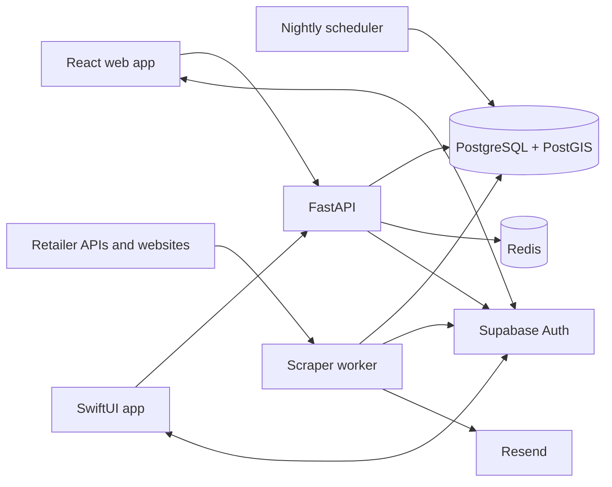
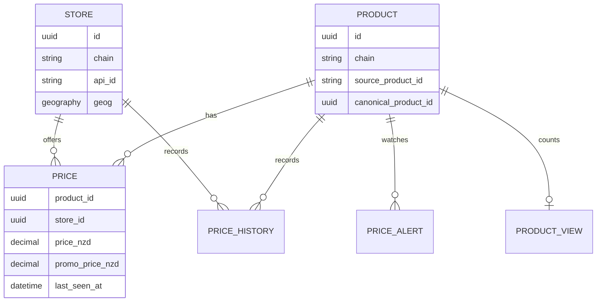

# Architecture

> **TL;DR:** Retailer-specific scrapers normalize prices into PostgreSQL. FastAPI reads that data for the web and iOS clients, using PostGIS for nearby results and Redis for short-lived state. PostgreSQL is the only application data source of truth.

This document describes the current system and the boundaries contributors should preserve. The code remains authoritative for endpoints, tables, and supported retailers.

## System at a glance

The API, scheduler, and worker share database models and services but run as separate processes. Clients never contact retailer sources or the database directly.

## Runtime components

| Component | Responsibility | Durable state |
| --- | --- | --- |
| Web (`web/`) | React interface, browser location, filters, maps, and account flows | Browser storage only |
| iOS (`ios/`) | Native SwiftUI client with the same public API contract | Device storage only |
| API (`api/app/main.py`) | Validation, search, accounts, alerts, admin ingestion, and health checks | PostgreSQL |
| Scheduler (`api/app/workers/scheduler.py`) | Inserts deduplicated nightly jobs using Auckland time | Ingestion jobs in PostgreSQL |
| Worker (`api/app/workers/runner.py`) | Claims jobs, renews leases, runs scrapers, and evaluates alerts | Job and ingestion records in PostgreSQL |
| PostgreSQL/PostGIS | Products, stores, prices, users' application data, history, and geospatial queries | Yes |
| Redis | Response cache, rate-limit state, and revoked admin tokens | No |
| Supabase Auth | End-user identity and JWT issuance | External |
| Resend | Price-alert email delivery | External |

FastAPI's generated `/docs` page is the canonical API reference. Alembic migrations in `api/alembic/versions/` are the canonical physical schema history.

## Backend boundaries

The backend is split by responsibility:

- `routes/` owns HTTP validation, authentication dependencies, and response contracts.
- `services/` owns reusable business rules such as search, pricing, canonical matching, freshness, and alerts.
- `scrapers/` owns source-specific fetching and parsing.
- `workers/` owns scheduling and post-ingestion jobs.
- `db/` owns SQLAlchemy models, sessions, and transactions.
- `schemas/` owns Pydantic request and response models.

Routes should stay thin. Retailer quirks belong in their scraper, while rules shared across retailers belong in services.

## Core data model

The important invariants are:

- A product is unique by retailer chain and source product ID.
- A store is unique within a chain by name or retailer ID.
- There is one current price per product/store pair.
- Price history is append-only and separate from current price state.
- A promotion is effective only while its end date is absent or in the future.
- `canonical_product_id` is a deterministic cross-chain match key, not a foreign key.
- Stores marked `sells_alcohol = false` are excluded from search results.

User IDs in preferences and alerts refer to Supabase users; Liquorfy does not duplicate the Supabase user table.

## Ingestion flow

The registry in `api/app/scrapers/registry.py` maps chain names to scraper implementations.

1. The scheduler or admin API inserts an `ingestion_jobs` row. A dedupe key makes each nightly chain/date request idempotent.
2. A worker atomically claims a ready row with `FOR UPDATE SKIP LOCKED`, assigns itself a lease, and increments the attempt count.
3. The worker renews the lease while the scraper fetches its retailer API or website.
4. The scraper creates an `ingestion_runs` record for the attempt.
5. Shared parsers infer brand, category, volume, pack size, ABV, and sugar-free status.
6. Canonical matching computes a deterministic ID for likely equivalent products across chains.
7. Products, stores, and current prices are upserted in batches.
8. Price changes append observations to `price_history`; unseen or expired promotions are cleared.
9. The worker completes the job or requeues it with exponential backoff. Another worker can recover an expired lease.
10. After processing, the worker performs reporting and price-alert evaluation.

Only one queued or running job may exist for a chain. Multiple workers can claim different chains without blocking one another. Scraper writes remain idempotent because delivery is at least once.

## Product read flow

1. A client sends filters and, for nearby discovery, a New Zealand location and radius.
2. The API validates the query and builds a cache key from all result-affecting parameters.
3. Redis returns a cached JSON response when available.
4. On a miss, PostgreSQL filters stores with PostGIS and joins current product and price data.
5. Search computes effective price, distance, price per 100 ml, and price per standard drink.
6. The serialized response is cached briefly and returned.

Redis failures do not block normal product reads: the API falls back to PostgreSQL. Database failures do block them.

## Identity and alerts

End users authenticate with Supabase. The clients attach the Supabase access token, and the API verifies its signature and uses the `sub` claim as the user ID.

Administration is separate: `/auth/login` issues a Liquorfy HS256 token for protected ingestion endpoints. Logout stores a token hash in Redis until expiry. If Redis cannot verify revocation, admin authorization fails closed.

Price alerts belong to Supabase user IDs. After ingestion, the worker finds qualifying current prices, suppresses unchanged repeat notifications, obtains the user's email from Supabase, and sends through Resend.

## Current constraints

- PostgreSQL is both the system of record and the job broker; database unavailability pauses enqueueing, claiming, and heartbeats.
- Queue delivery is at least once. A lease can expire immediately before completion is committed, so scraper writes must remain idempotent.
- Running cancellation is cooperative and is observed on the next heartbeat.
- Cache entries expire by TTL; ingestion does not centrally invalidate all affected product keys.
- Cross-chain product matching is deterministic and heuristic, so parsing quality directly affects comparison quality.
- Retailer integrations are external dependencies and can fail independently when their APIs, markup, or anti-bot controls change.

These are current architectural facts, not hidden guarantees. New work that changes one should update this document and add the corresponding operational handling.
