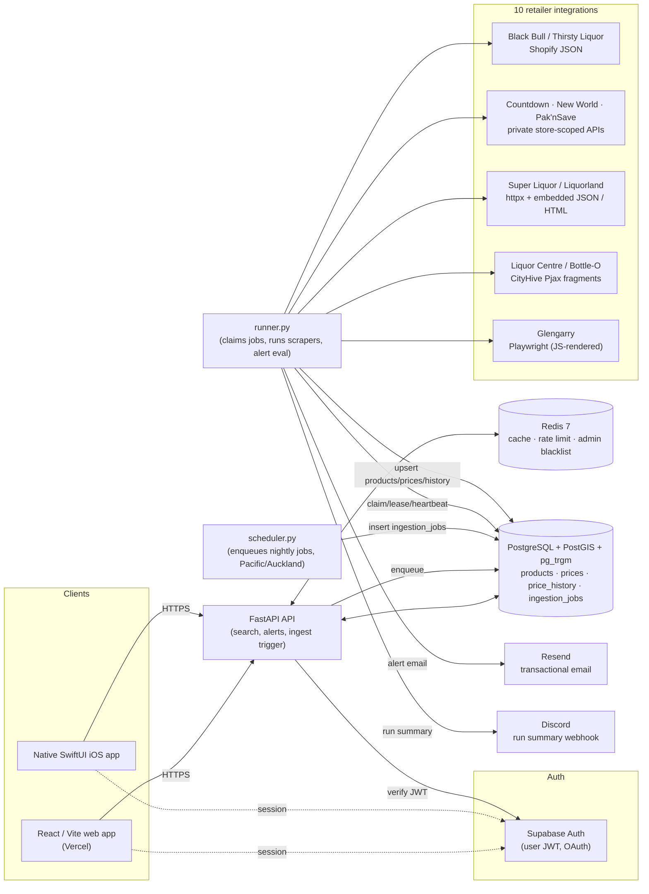
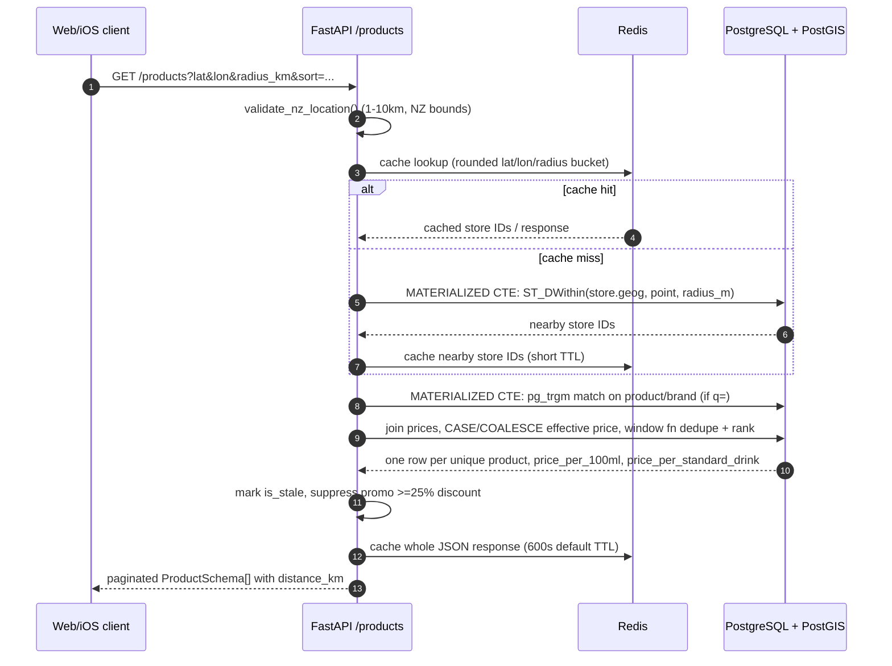
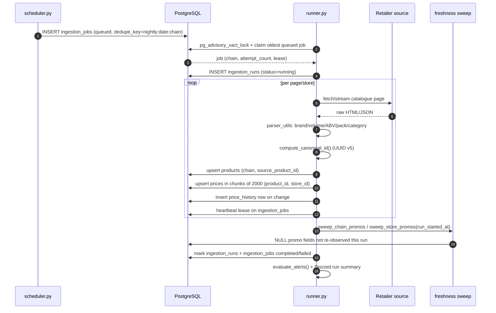
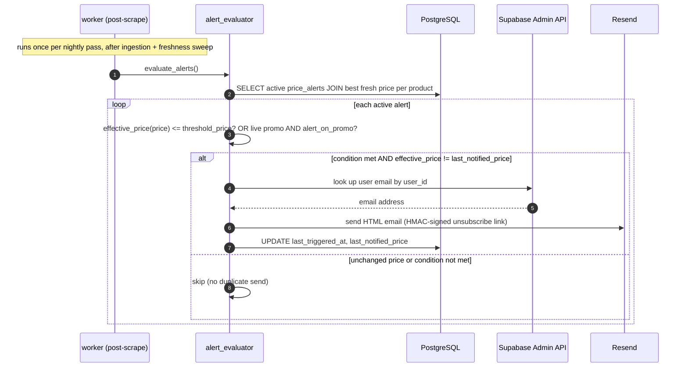

# Liquorfy Interview Handbook

**A code-grounded guide to explaining, defending, and improving the project**

**Repository snapshot:** committed `main` at `ab07aed` (23 July 2026), re-verified 29 July 2026 against the previous snapshot at `c16e42a` (21 June 2026).  
**Audience:** the project owner preparing for software engineering, full-stack, backend, mobile, or system-design interviews.

> This handbook prioritises the current code over older repository documentation. Where the working tree contains uncommitted changes, or a guide conflicts with the implementation, that is called out explicitly.

## Refresh log — what changed between `c16e42a` and `ab07aed`

Eleven commits landed between the two snapshots. Two were substantive engineering changes, not just cleanup, and they invalidated several claims the previous edition made with confidence:

| Commit | What it actually did | Handbook claims it invalidated |
|---|---|---|
| `2549bc9` Remove dead scraper code and clean API utilities | Deleted four unused Countdown store-list variants (`countdown_stores.py`, `_final.py`, `_network.py`, `_simple.py`, ~516 lines) and trimmed unused imports across scrapers/services | None — this was pure deletion of code the previous handbook never referenced |
| `0eeefab` Adopt reproducible API quality gates | Replaced Poetry with `uv` in CI and locally; added `ruff check`, `mypy`, and `alembic -c api/alembic.ini check` (a real ORM/migration drift gate) to the test job; pinned `uv==0.11.26` | "CI installs Python 3.11 and Poetry" (§13); "no automated schema-drift check" (§14) |
| `301bc69` Make ingestion jobs durable | Added a committed `ingestion_jobs` table (leases, heartbeats, retries, cancellation, per-chain dedupe) plus a standalone `scheduler.py` process; `/ingest/run` now enqueues a durable row instead of an in-process `asyncio.create_task` | "Manual ingestion caveat" / Priority 1 item about non-durable in-process jobs (§13, §16) |
| `6e94f4b` Harden API authentication and user data | Admin login now verifies bcrypt (`ADMIN_PASSWORD_HASH`) when configured, and `Settings` refuses to boot in production without it | "Admin passwords are compared as plaintext… bcrypt helpers exist but are not used" (§12, Q42) |
| `6e2bec7` Reconcile API schema and money types | Converted `price_nzd`, `promo_price_nzd`, and alert threshold columns from `Float` to `Numeric(10,2)`, and committed real Alembic migrations for `user_preferences` and `price_alerts` (previously described as un-migrated, Supabase-only tables) | "Committed models use floating point" / "uncommitted hardening" (§6, Q18) |
| `a6866b7` Refactor product search and validation | Split the 647-line `search.py` into `search.py`, `search_support.py`, `discovery.py`, `product_detail.py`, and `product_presenter.py` | File-path references in the code-walkthrough map (§19) |
| Also present but timezone-relevant | `workers/scheduler.py` now imports `zoneinfo.ZoneInfo("Pacific/Auckland")` directly — the fixed-UTC+13 bug the previous handbook flagged as a red flag is fixed in the code already at this snapshot | "Fixed UTC+13 scheduler" red flag (§13, Q46, §22) |

Each fix is called out again inline, next to the relevant section, as a **Verified vs. documented** note — this handbook is meant to model checking the code rather than trusting the last pass.

## How to use this handbook

Use the material in three passes:

1. **First pass - tell the story.** Learn the 30-second pitch, the architecture, and the three hardest problems.
2. **Second pass - defend the implementation.** Be able to trace search, scraping, matching, freshness, authentication, and alerts from client to database.
3. **Third pass - show engineering judgement.** Know the trade-offs, current weaknesses, and the next changes you would make.

Do not memorise every class name. Memorise the system’s invariants, why the main decisions were made, and where the code that enforces each invariant lives.

## 1. The answer to “Tell me about Liquorfy”

### 30-second version

Liquorfy is a location-aware liquor price comparison platform for New Zealand. It collects catalogue and store-specific pricing from ten retailer integrations, normalises inconsistent product data, matches equivalent products across chains, and serves nearby results through a FastAPI API to both React and native SwiftUI clients. The interesting engineering is in reliable ingestion, geospatial search, comparable value metrics, promo freshness, and deterministic cross-chain matching. PostgreSQL with PostGIS is the source of truth, Redis handles caching and distributed rate-limit state, Supabase provides user identity, and a separate worker performs nightly collection and price-alert evaluation.

### 90-second version

Liquorfy answers a deceptively difficult question: “Where is this exact product cheapest near me?” Retailers expose data through very different mechanisms-Shopify JSON, private supermarket APIs, server-rendered HTML, embedded JSON, Pjax fragments, and browser-rendered pages. A dedicated worker runs those integrations, converts every listing into a common product-and-price shape, and upserts it into PostgreSQL. Prices are stored per product and store, while an append-only history records changes.

The system then normalises pack size, volume, ABV, category, and brand. It creates a deterministic UUID v5 fingerprint from brand, variant, total volume, pack count, and sugar-free status so equivalent listings from different chains can be compared. Search uses PostGIS for true-radius queries, trigram indexes for partial text matching, SQL window functions for deduplication, and Redis for short-lived response and nearby-store caching. Results include price per 100 ml and price per standard drink, which are more useful than sticker price alone.

The product has a React/Vite web app and a native SwiftUI iOS app sharing the same API. Supabase issues user JWTs for alerts and account features, while a separate admin JWT protects ingestion. The main trade-off is that retailer scraping is inherently brittle, so the design emphasises partial progress, idempotent upserts, retries, run telemetry, promo sweeping, and graceful handling of stale data.

### The three hardest problems

1. **Heterogeneous ingestion:** ten chains publish data differently, and several vary price by store.
2. **Entity resolution:** the same physical product is named differently across retailers.
3. **Trustworthy freshness:** a disappeared or expired special must not continue to win a comparison.

### What makes the project more than CRUD

- It integrates uncooperative and changing external data sources.
- It solves domain-specific parsing and entity resolution.
- It performs real geospatial queries with legal-store filtering.
- It computes comparable value metrics rather than only displaying scraped prices.
- It separates an unreliable, resource-heavy write path from a latency-sensitive read path.
- It supports two independently implemented clients against one contract.

## 2. Product and domain model

### User problem

Sticker prices are not directly comparable. A 6-pack, a 12-pack, a 700 ml spirit, and a 1 L bottle represent different quantities and alcohol content. A useful comparison also depends on which stores are near the user and whether a promotion is still valid.

### Core user journeys

- Enable or manually select a New Zealand location and search within a 1–10 km radius.
- Browse nearby products by category, chain, store, price, promotion, or search term.
- Sort by relevance, discount, price per 100 ml, price per standard drink, total price, recency, or distance.
- Open a product, compare stores and matched cross-chain listings, and inspect 30-day price history.
- Save favourites locally and retrieve their current enriched prices in a batch.
- Sign in through Supabase and create a threshold or on-promotion price alert.
- Receive an email after collection finds a qualifying new price.

### Important domain rules

- The effective price is the promotional price only while the promotion has not expired.
- A price not seen for more than seven days is stale.
- Promotions at or above a 25% discount are excluded or suppressed in product responses to comply with the project’s interpretation of New Zealand alcohol advertising restrictions.
- Stores marked `sells_alcohol = false` are always excluded. This handles West Auckland licensing-trust areas.
- Radius must be from 1 to 10 km, and product-route location input must fall inside broad New Zealand bounds.
- Supermarkets supply beer and wine but not spirits.
- A product-store pair must be unique.
- A chain’s source product identifier must be unique within that chain.

### Value calculations

Price per 100 ml:

```text
price_per_100ml = effective_price / (total_volume_ml / 100)
```

Standard drinks:

```text
standard_drinks =
  volume_litres × alcohol_fraction × 0.789 / 0.010
```

Price per standard drink:

```text
price_per_standard_drink = effective_price / standard_drinks
```

`0.789` is the approximate density of ethanol in kg/L, and `0.010` represents 10 g of alcohol in a New Zealand standard drink.

## 3. Architecture at a glance

```text
React/Vite web ───────┐
                      ├── HTTPS ──> FastAPI ──> PostgreSQL + PostGIS
Native SwiftUI iOS ───┘                 │              ▲
                                       │              │
                                  Redis cache          │
                                       │              │
Supabase Auth ── JWT verification ──────┘      nightly worker
                                                      │
Resend <── alert evaluation <─────────────────────────┤
Discord <── run summary <─────────────────────────────┤
                                                      ▼
                                            10 retailer sources
```



The API and worker never call each other directly — they only meet through PostgreSQL (product/price rows) and, for ingestion triggers, through the `ingestion_jobs` table. That row-based handoff is what let ingestion durability (`301bc69`) be added without touching the read path at all.

### Component responsibilities

| Component | Responsibility | Key technology |
|---|---|---|
| Web client | Discovery, filters, maps, favourites, alerts, account UI | React 18, TypeScript, Vite, Tailwind, MapLibre |
| Native client | iOS-native version of the same journeys | SwiftUI, Observation, MapKit, Swift Charts, Supabase Swift |
| API | Validation, search, geospatial queries, auth enforcement, response shaping | FastAPI, Pydantic v1, async SQLAlchemy |
| Worker | Scheduled collection, retry, cleanup, alert evaluation, reporting | asyncio, SQLAlchemy, httpx, Playwright |
| Database | Products, stores, prices, history, runs, views, user-facing records | PostgreSQL, PostGIS, pg_trgm |
| Redis | Response cache, nearby-store cache, production rate limits, admin-token blacklist | Redis 7 |
| Supabase | End-user authentication and admin user lookup for alert email addresses | Supabase Auth |
| Resend | Transactional price-alert email | HTTP API |

### The most important boundary

The API and worker do not call each other to exchange catalogue data. They meet through the database. This is a strong design choice because scraping has high latency, external failure modes, and browser memory costs, while the API must remain responsive. Production even uses separate container images: a lean API image and a larger worker image with Playwright Chromium.

## 4. End-to-end flows

### Flow A - nearby product search

1. The web `LocationContext` or iOS `LocationManager` obtains or restores a location.
2. The client serialises filters into `/products` query parameters.
3. FastAPI parses them into `ProductQueryParams`.
4. The route requires location for normal browsing, but permits a small first-page promotion query or text search without location.
5. `fetch_products` filters out stores that cannot sell alcohol.
6. With a text query, materialised CTEs prefilter matching products and nearby stores.
7. Without a text query, nearby store IDs are obtained through a Redis-cached PostGIS radius query.
8. SQL computes live effective price, discount ratio, value metrics for sorting, and optional distance.
9. When `unique_products` is enabled, a window partitions by normalised name, pack count, and volume and selects one row.
10. The API reshapes the chosen row, computes display metrics, marks stale prices, and suppresses disallowed promotion display.
11. The whole JSON response is cached for the configured TTL, currently 600 seconds by default.



### Flow B - nightly ingestion

1. `scheduler.py` polls every 60 seconds; once the Pacific/Auckland clock passes the configured hour (`LIQUORFY_SCHEDULE_HOUR`, default 02:00), it inserts one durable `ingestion_jobs` row per chain, guarded by a per-chain unique index (`status IN ('queued','running')`) and a `dedupe_key` of `nightly:{date}:{chain}` so restarts and multiple scheduler replicas can't double-enqueue.
2. `runner.py` claims a queued job under a Postgres advisory lock, sets it to `running`, and heartbeats a lease (`lease_expires_at`) so a crashed runner's job becomes reclaimable rather than stuck.
3. It also checks database connectivity at startup and reclaims/fails jobs whose lease has expired.
4. Each scraper creates an `ingestion_runs` telemetry record with status `running` and loads stores for its chain.
5. It fetches or streams pages, parses them into a shared dictionary shape, and persists each page in its own transaction.
6. Products are upserted on `(chain, source_product_id)`.
7. Prices are upserted on `(product_id, store_id)` in chunks of 2,000.
8. A changed or new product-store price creates a `price_history` row.
9. `last_seen_at` is refreshed on every observed price; `price_last_changed_at` changes only with meaningful price state.
10. Missing promotions are swept after successful observation, either chain-wide or store-by-store.
11. The `ingestion_runs` row is marked completed or failed with counts and an error message; the `ingestion_jobs` row is marked completed/failed/cancelled, with up to `max_attempts` (default 2) retries on failure.
12. At the end of the pass, the worker sends a Discord summary and evaluates alerts.



> **Verified vs. documented:** the previous handbook described `/ingest/run` as spawning an in-process `asyncio.create_task` with status in a Python dict — "not a durable distributed queue." Reading `api/app/routes/ingest.py`, `api/app/workers/tasks.py`, and `api/app/db/models.py` (`IngestionJob`) confirms that's no longer true: ingestion is now a real Postgres-backed queue with leases, heartbeats, retries, and cancellation (commit `301bc69`, "Make ingestion jobs durable"). Priority 1 in §16 and the red-flag list in §22 have been updated accordingly.

### Flow C - cross-chain product comparison

1. The parser extracts or infers brand, volume, pack count, ABV, category, and sugar-free status.
2. The matcher strips brand, volume, pack, ABV, generic noise, and generic liquor-type words from the name to isolate a variant.
3. It hashes `brand | variant | total_volume_ml | pack_count | is_sugar_free` into UUID v5.
4. Category and ABV are intentionally excluded because retailer metadata is inconsistent.
5. Product detail queries all other products with the same canonical ID.
6. It selects the cheapest store per chain and returns those as `cross_chain_prices`.

### Flow D - price alert

1. The client signs in with Supabase and sends the access token as a bearer token.
2. FastAPI verifies an HS256 token using the configured secret or an ES256 token through Supabase JWKS.
3. The user creates an alert for a threshold, a future promotion, or both.
4. After scraping, the evaluator joins each active alert to its product’s best fresh price.
5. It triggers when the effective price is at or below the threshold or when a live promotion exists.
6. It suppresses duplicate mail if the effective price equals `last_notified_price`.
7. It looks up the user’s email through the Supabase Admin API.
8. Resend sends an escaped HTML email with a signed one-click unsubscribe URL.
9. The evaluator updates `last_triggered_at` and `last_notified_price`.



The stale-price guard matters here: `alert_evaluator` joins to each product's best *fresh* price, so a price that has not been re-observed within the seven-day window should not silently trigger or suppress an alert on old data — see the "Important limitation" callout in §9 for where staleness is, and is not, consistently enforced elsewhere in the read path.

### Flow E - favourites and recently viewed

- Favourites are local-first, stored in browser `localStorage` or iOS local persistence.
- The clients batch product IDs through `POST /products/batch` to refresh current pricing.
- A product-detail visit posts to `/{product_id}/view`.
- PostgreSQL increments `product_views` with an upsert.
- Autocomplete blends trigram similarity with a small logarithmic popularity boost.
- “Popular” means view-count-ranked products whose last view was within seven days.

## 5. Backend internals

### Application composition

`api/app/main.py` builds one FastAPI application and mounts routers for:

- alerts
- admin authentication
- health
- products
- stores
- user preferences/account deletion
- ingestion
- worker monitoring

Middleware adds:

- request IDs, accepting `x-request-id` or generating a UTC timestamp;
- environment-aware CORS;
- security headers;
- SlowAPI rate limiting with memory storage in development and Redis in production;
- consistent handling for Pydantic validation and unexpected exceptions.

### Configuration

`Settings` uses Pydantic `BaseSettings`, reads `.env`, and caches one instance with `lru_cache`. Important configuration includes database and Redis URLs, cache TTL, radius, CORS, admin credentials, Supabase, Resend, and feature flags.

The secret key must be at least 32 characters. Admin-password checks only warn; they do not enforce a strong password.

### Database sessions

The database module adapts one URL into:

- `postgresql+asyncpg` for async API paths;
- `postgresql+psycopg` for synchronous utilities.

It translates `sslmode=require` for asyncpg and disables prepared statements for PgBouncer/Supavisor transaction pooling. Pools use pre-ping, recycling, and bounded overflow. `get_async_session` leaves commit responsibility to the caller; `async_transaction` commits automatically and rolls back on exception.

### API surface

| Method and path | Purpose | Auth |
|---|---|---|
| `GET /healthz` | Process liveness | Public |
| `GET /health` | DB and Redis dependency health | Public |
| `GET /readiness` | Traffic readiness | Public |
| `GET /products` | Filtered, sorted, paginated search | Public |
| `GET /products/autocomplete` | Fuzzy/popularity suggestions | Public |
| `GET /products/popular` | Seven-day popular products | Public |
| `POST /products/batch` | Current details for up to a practical client batch | Public |
| `POST /products/{id}/view` | Increment popularity | Public |
| `GET /products/{id}` | Product, stores, cross-chain prices, history | Public |
| `GET /stores` | Nearby legal alcohol-selling stores | Public |
| `POST /auth/login` | Admin JWT | Public credential check |
| `POST /auth/logout` | Add admin JWT to Redis blacklist | Bearer token supplied |
| `POST /ingest/run` | Trigger one or all chain jobs | Admin JWT |
| `GET /worker/health` | Latest run per scraper and overall status | Public |
| `GET /worker/runs` | Run history | Public |
| `GET /worker/runs/{id}` | Run detail | Public |
| `POST/GET/PATCH/DELETE /alerts` | Alert lifecycle | Supabase user JWT |
| `GET/PUT /user/preferences` | User defaults | Supabase user JWT |
| `DELETE /user/account` | Supabase account deletion | Supabase user JWT |

### Search engineering

The search implementation is one of the strongest interview topics.

- `pg_trgm` GIN indexes support partial case-insensitive product and brand search.
- PostGIS stores a generated `geography(Point, 4326)` and a GiST index supports `ST_DWithin`.
- A text search uses two `MATERIALIZED` CTEs so PostgreSQL narrows text and geographic candidates before the larger joins.
- Location-only requests cache nearby store IDs using rounded latitude, longitude, and radius buckets.
- SQL `CASE` and `COALESCE` determine valid promotion and effective price.
- Window functions choose a representative unique listing and compute minimum nearby price and store count in the same partition.
- Every sort adds deterministic tie-breakers to stabilise pagination.
- Page size is clamped to 1–100.
- Category filtering expands a parent into its direct subcategories.

### A subtle mismatch to understand

Search-list deduplication groups by formatted source-name characteristics, while product-detail cross-chain matching uses the canonical UUID. They solve related but different problems:

- list deduplication asks “show one nearby listing for this apparent product”;
- canonical matching asks “are these cross-retailer records the same physical SKU?”

An improvement would be to use canonical IDs more consistently once coverage and false-positive rates are well measured.

## 6. Database model and invariants

### Committed schema

| Table | Key role | Important constraints/indexes |
|---|---|---|
| `stores` | Retail locations and legal availability | unique chain/name and chain/api_id; generated geography; chain and GiST indexes |
| `products` | Chain-specific catalogue record | unique chain/source ID; chain, trigram, and partial canonical indexes |
| `prices` | Current product-store offer | unique product/store; price, promo, freshness, FK, expiry indexes |
| `price_history` | Append-only changes | product+recorded and recorded-time indexes |
| `ingestion_runs` | Run telemetry | chain/status and chain/start indexes |
| `ingestion_jobs` | Durable ingestion job queue | one active job per chain; partial index on `dedupe_key`; partial indexes on queued/expired-lease rows |
| `product_views` | Popularity aggregate | one row per product; view-count index |
| `user_preferences` | Signed-in defaults | location + radius (1-10km) check constraints |
| `price_alerts` | Threshold/promo alert state | FK to product, positive-threshold check, user/active and product/active indexes |

> **Verified vs. documented:** the previous edition described `price_alerts` and `user_preferences` as living only in the Supabase-hosted database, "apparently provisioned… rather than represented by committed Alembic migrations." Reading `api/app/db/models.py` and `api/alembic/versions/m1n2o3p4q5r6_reconcile_api_schema.py` shows both are now first-class ORM models with real, committed migrations (commit `6e2bec7`, "Reconcile API schema and money types"). CI now also runs `alembic check` (commit `0eeefab`), which fails the build if the ORM and migrations drift apart — closing the "no automated schema-drift check" gap the previous edition raised in §14.

### Why idempotent upserts matter

Retailer jobs are rerun frequently and may repeat pages. Upserts guarantee reprocessing refreshes existing rows rather than creating duplicates. The key selection matters:

- product identity at a source: chain plus source ID;
- offer identity: product plus store;
- store identity: chain plus API ID or stable name.

### Why append-only history is separate

The current price table is optimised for serving present state. History is only written on change, preventing every nightly observation from creating another identical row. Detail queries can aggregate the best recorded price per day without bloating the serving table.

### Money representation

`price_nzd`, `promo_price_nzd`, `threshold_price`, and `last_notified_price` are all `Numeric(10, 2)` in the committed ORM (`MONEY_TYPE = Numeric(10, 2, asdecimal=True)` in `api/app/db/models.py`), backed by `Decimal` in Python — not floating point. Positive-price check constraints (`ck_price_positive`, `ck_price_history_positive`, `ck_price_alert_threshold_positive`) enforce `> 0` at the database layer too.

> **Verified vs. documented:** the previous edition said "committed models use floating point for prices… the working-tree conversion to fixed-scale numeric is the correct long-term approach." That conversion has since landed (commit `6e2bec7`) with a real migration, so the float-vs-decimal risk this handbook used to flag as open technical debt is resolved. It's kept here as a worked example of *why* the change mattered, not as a live gap — see §17 Q18 for the "float or decimal" interview answer, updated to describe the resolved state.

## 7. Retailer ingestion matrix

| Chain | Current technique | Pricing scope | Important detail |
|---|---|---|---|
| Black Bull | Shopify JSON over httpx | Per-store | Loads e-commerce domains from DB, falls back to three known stores |
| Thirsty Liquor | Shopify JSON over httpx | Chain-wide | Collections paginated at up to 250 products |
| Woolworths/Countdown | Private API with per-store session | Per-store | Separate cookie jar per store; store selection is session-global |
| New World | Foodstuffs private API | Per-store | Shared Foodstuffs base with store-specific searches |
| Pak’nSave | Foodstuffs private API | Per-store | Same infrastructure as New World |
| Super Liquor | HTTP/HTML catalogue | Chain-wide | Special pages and regular catalogue need reconciliation |
| Glengarry | Playwright browser | Chain-wide | JavaScript-rendered specialist catalogue |
| Liquorland | httpx plus embedded `window.category` JSON | Chain-wide | Replaced Playwright; SaleFinder provides specials |
| Liquor Centre | Pjax HTML fragments | Per-store | CityHive subdomains; persists by store identifier |
| Bottle-O | Pjax HTML plus franchise fallback | Per-store | CityHive stores with fallback catalogue path |

### Scraper base contract

Each scraper supplies:

- a chain identifier;
- catalogue fetching or streaming;
- parsing to the common dictionary;
- optionally a custom per-store run path.

The shared base owns ingestion-run telemetry, normalised product construction, canonical matching, bulk upserts, change detection, history insertion, and chain-level promo sweeping.

### Resilience techniques

- Fetch retries with exponential backoff.
- Chain timeouts: two hours normally, five hours for Liquorland.
- One retry per failed chain at scheduler level.
- Short delays between chains and respectful per-site throttling.
- Streaming and per-page commits to retain partial progress.
- 2,000-row write chunks to avoid PostgreSQL bind-parameter limits.
- Browser resource blocking for images, media, fonts, and stylesheets.
- Browser restarts or separate contexts where long-lived sessions become fragile.
- “Zombie” run cleanup after worker restart.
- Fallback source strategies for authentication, stores, categories, and franchise catalogues.

### Store-specific price trap

The shared base writes one parsed price to every chain store, which is correct only for chain-wide pricing. Per-store scrapers therefore override persistence and set `_sweep_per_store = True`. If a new scraper varies by location but accidentally uses the shared chain-wide path, it can assign one branch’s price to the whole chain. This is a critical review question when adding integrations.

### Adding a new retailer

1. Identify the cheapest stable data source: documented feed, public JSON, internal API, embedded JSON, Pjax/SSR, plain HTML, then browser as a last resort.
2. Determine whether price and availability are chain-wide or per-store.
3. Define a stable source product ID and store identity.
4. Implement parsing through `build_product_dict` where possible.
5. Add representative fixtures and parser tests.
6. Register the chain.
7. Seed or collect stores and coordinates.
8. Test a small live run, rerun it to prove idempotency, then test a price change.
9. Confirm promo sweep scope and failure behaviour.
10. Add monitoring thresholds and update the current architecture documentation.

## 8. Normalisation and entity resolution

### Parsing

`parser_utils.py` handles:

- CityHive abbreviations such as `330c`, `330b`, and `700m`;
- forms such as `12 x 330 ml`, `12pk 330ml`, pack-only descriptors, litres, and centilitres;
- ABV extraction;
- category inference and category hierarchy;
- brand inference from a large curated rule set;
- name formatting and removal of duplicate brand/region words;
- sugar-free and low-carb keyword detection.

The code also applies domain defaults when volume cannot be extracted: 750 ml for single wines and 700 ml for single spirits.

### Canonical ID design

UUID v5 is deterministic: the same normalised key always produces the same identifier without a central matching service. This makes ingestion stateless and makes backfills reproducible.

Inputs:

- inferred brand;
- variant descriptor;
- total volume;
- pack count;
- sugar-free flag.

Deliberate exclusions:

- **category**, because chains use incompatible taxonomies;
- **ABV**, because chains inconsistently include it;
- **chain**, because the purpose is cross-chain matching.

### Failure modes

- False negatives when brand or size cannot be parsed.
- False negatives when equivalent variants use unrelated wording.
- False positives where two brand/size/variant keys refer to distinct packaging.
- Product renames can change the deterministic ID.
- Category defaults may infer a conventional volume incorrectly.

### How to improve matching

Keep the deterministic matcher as the high-precision baseline, then add:

- match-confidence scores and explainable features;
- GTIN/barcode matching where available;
- curated aliases for known brands and variants;
- a review queue for high-value ambiguous pairs;
- precision/recall measurement on a labelled dataset;
- versioned matcher keys so algorithm upgrades can be migrated safely.

## 9. Freshness and correctness

### Three layers

1. **Observation sweep:** after a run, clear promo fields not seen since the run began.
2. **Expiry cleanup:** every worker loop clears promotions whose explicit end date has passed.
3. **Read-time scepticism:** mark anything not observed in seven days as stale.

Price history older than 30 days is periodically deleted, matching the 30-day product-detail chart.

### Correctness versus availability

Redis cache failures are handled as a performance degradation: search continues and produces fresh data. Admin-token revocation checks fail closed: if Redis is unavailable, protected admin access is denied. This difference is deliberate:

- cached reads can safely fall back to PostgreSQL;
- revocation state is security-sensitive, so uncertainty should not grant access.

### Important limitation

The API marks a price as stale but does not universally filter stale rows out. Older architecture prose says stale prices cannot win, but the current list query does not put staleness into every sort order. Treat that as documentation drift and a potential correctness improvement: exclude stale offers or rank them after fresh offers in SQL.

> **Verified vs. documented:** re-checked at `ab07aed` by reading `api/app/services/search.py`, `search_support.py`, and `discovery.py` (all rewritten in commit `a6866b7`, "Refactor product search and validation") for any `is_stale` or staleness predicate in the list/search path — there isn't one. `STALE_THRESHOLD` (seven days) and the `is_stale` flag live in `api/app/services/product_presenter.py` and are only used to *label* a row in the response, not to filter or re-rank it. This is a real, still-open gap, not something the refactor happened to fix — worth volunteering in an interview rather than letting it be discovered. Contrast this with `alert_evaluator.py`, which *does* filter to `last_seen_at > now() - interval '7 days'` before picking a product's best price — the two code paths handle the same seven-day rule inconsistently.

## 10. Web client

### Stack and structure

- React 18 and TypeScript.
- Vite with route-level lazy loading and manual vendor chunks.
- React Router 7.
- Tailwind and Radix primitives.
- Axios API client.
- Supabase JS authentication.
- MapLibre with `react-map-gl` and Supercluster.
- Recharts for price history.
- Framer Motion for reveal effects.
- Vercel Analytics and Speed Insights.

### State strategy

There is no large global state library. State is split by lifetime:

- `AuthContext` for Supabase session and user;
- `LocationContext` for location, radius, modal flow, and five-minute local cache;
- URL query parameters for explore filters, allowing shareable/bookmarkable results;
- component hooks for request state and cancellation;
- `localStorage` for favourites, recently viewed, recent searches, saved filters, and notification preferences.

### Request-race handling

Product hooks keep an `AbortController` and a monotonically increasing request ID. A new request cancels the previous one, and late responses are ignored. This prevents fast filter changes from rendering stale data.

### Web performance

- Every route component is lazy-loaded.
- Map code is lazy-loaded because it is heavy.
- Store points are clustered client-side.
- Product cards and grids use memoisation.
- The production build succeeds.

The current build reports a map vendor chunk around 1.03 MB before gzip and 280 KB after gzip. That is the clearest frontend performance target: load it only when the map approaches the viewport, reduce dependencies, or investigate lighter map packaging.

### Web limitations

- There is no real frontend test suite or `npm test` script, even though CI runs `npm test || echo "No tests found"`.
- Several preferences are local-only and do not sync across devices.
- The comment in `LocationContext` says “5–40 km” while code and backend enforce 1–10 km.
- The API client asks Supabase for the session on every request; an in-memory token path could reduce overhead.
- Vercel’s catch-all rewrite serves the SPA but does not proxy the API; production must set `VITE_API_URL`.

## 11. Native iOS client and the legacy Capacitor path

### Native SwiftUI app

The primary native app under `ios/` is not merely a wrapper. It has:

- SwiftUI navigation using a typed `AppDestination`;
- `@Observable` managers and view models;
- an `actor`-based API client;
- Core Location and MapKit;
- Swift Charts for price history;
- Supabase Swift authentication;
- local managers for favourites, recently viewed, searches, and filters;
- model parity with cross-chain prices, alerts, popularity, and product detail.

The native client attaches Supabase bearer tokens, decodes fractional or normal ISO 8601 timestamps, and exposes the same browse, compare, watchlist, alert, and account journeys as the web app.

### iOS testing

There are 38 native tests across:

- API request construction and client behaviour;
- formatting;
- model decoding;
- New Zealand bounds validation.

### Capacitor

`web/ios/` and several mobile guides describe a Capacitor wrapper. That path still exists, but the repository also contains a much fuller native app. In an interview, say the project evolved from web reuse through Capacitor toward a native SwiftUI experience, and that documentation should now name one supported mobile strategy or clearly distinguish both.

### Mobile configuration consideration

The iOS app embeds the Supabase anonymous key. Anonymous client keys are designed to be public when Row Level Security and backend authorisation are correct; they must never be confused with the service-role key. The API base URL is also compiled into the app, so environment-specific configuration would improve development and staging.

## 12. Authentication, authorisation, security, and privacy

### Two authentication systems

**Admin path**

- Username comes from environment configuration; password is verified against `ADMIN_PASSWORD_HASH` (bcrypt) when set, falling back to a plaintext env-var comparison only when it is not.
- Production refuses to start without `ADMIN_PASSWORD_HASH` set (`Settings.validate_production_admin_auth`).
- An HS256 JWT is issued with a configurable TTL (`ADMIN_TOKEN_TTL_SECONDS`, default 3600s / 1 hour, bounded 300s-43200s / 5 minutes to 12 hours).
- `/ingest/run` and the job-management routes require the token.
- Logout hashes the token and stores it in Redis until expiry.
- Revocation checks fail closed.

**End-user path**

- Supabase handles registration, password login, OAuth, password recovery, and session refresh.
- The API validates HS256 legacy tokens or ES256/JWKS tokens.
- Routes use the JWT subject as a UUID user ID.
- User/account and alert operations scope queries to that ID.

### Security controls

- Environment-specific CORS.
- Production CORS rejects wildcard-with-credentials.
- HSTS in production.
- CSP, clickjacking, MIME-sniffing, referrer, and permissions headers.
- Default rate limit of 60 requests per minute per IP.
- Pydantic validation and route-level geographic/radius validation.
- HTML escaping in emails and URL-scheme checks for CTA links.
- HMAC-signed unsubscribe tokens.
- Non-root production containers.
- Redis authentication in production compose.
- Generic 500 responses rather than exposing exception details.

### Honest gaps

- Admin login still falls back to a plaintext `hmac.compare_digest` comparison in any environment where `ADMIN_PASSWORD_HASH` is unset — production is guarded against this by a config validator, but local/dev and any misconfigured non-production deploy are not.
- Admin login is not explicitly decorated with a tighter per-route rate limit.
- Worker-monitoring endpoints expose operational data publicly.
- `POST /products/{id}/view` is public and can be inflated.
- There is no RBAC, MFA, audit log, or admin account store.
- The security guide claims all passwords are hashed and SQLAlchemy hides passwords, but the current implementation does not support those claims.
- The API and Nginx define different CSP policies; the frontend’s inline styles and third-party connections need one tested production policy.
- A Liquorland SaleFinder credential-like value is committed in scraper source and should be assessed, rotated if sensitive, and moved to configuration if necessary.
- Account deletion depends on a highly privileged Supabase service-role key and should be carefully isolated and monitored.

> **Verified vs. documented:** the previous edition's top security gap was "admin passwords are compared as plaintext… bcrypt helpers exist but are not used by login." Reading `api/app/core/auth.py::create_token_with_credentials` and `api/app/core/config.py::validate_production_admin_auth` shows this changed in commit `6e94f4b` ("Harden API authentication and user data"): bcrypt verification via `ADMIN_PASSWORD_HASH` is now wired into login, and production boot fails without it. The residual gap — dev/misconfigured environments can still fall back to plaintext comparison — is real but materially smaller than what the last snapshot described, so it's listed above rather than as the headline weakness. The "user alert/preferences tables are not represented by committed migrations" gap from the previous edition is also resolved (see §6) and has been removed from this list rather than left stale.

### Privacy

Location is used for search and cached for five minutes in local client storage. Signed-in user preferences can store a default location. A robust privacy answer should mention data minimisation, retention, user deletion, least-privilege service credentials, and not logging exact location unnecessarily.

## 13. Reliability, deployment, and operations

### Local and production shapes

The repository supports:

- local PostgreSQL/PostGIS and Redis;
- a complete Docker Compose stack with `web`, `api`, `scheduler`, `worker`, `db`, and `redis` services;
- a Supabase-oriented compose file with only local API, worker, and Redis;
- a multi-stage Nginx web image;
- separate non-root API and Playwright-enabled worker images, plus a standalone scheduler process.

### CI/CD

GitHub Actions:

1. installs Python 3.11 and `uv` (pinned to `0.11.26`), then `uv sync --locked`;
2. starts PostgreSQL/PostGIS and Redis services;
3. runs `ruff check`, `mypy`, `alembic upgrade head`, and `alembic check` (an ORM/migration drift gate) before pytest;
4. installs Node 20 dependencies and builds the web app;
5. attempts a web test command but tolerates its absence (`npm test || echo "No tests found"`);
6. on `main`, builds and pushes API and web images to GHCR;
7. contains only a placeholder production deployment job.

The workflow still does not build the worker image or native iOS app. A mature pipeline should add those artefacts, frontend tests that actually run, security scanning, and a real deployment/rollback path.

> **Verified vs. documented:** the previous edition described CI as "installs Python 3.11 and Poetry" with "no automated schema-drift check." Reading `.github/workflows/ci-cd.yml` and `pyproject.toml` shows both claims are stale: the toolchain moved to `uv` and the test job gained `ruff`, `mypy`, and `alembic check` (commit `0eeefab`, "Adopt reproducible API quality gates"). `alembic check` specifically fails CI if the SQLAlchemy models and the migration history disagree — a real, enforced schema-drift gate, not just documentation intent.

### Health and monitoring

- `/healthz` proves the process is alive.
- `/health` and `/readiness` check PostgreSQL and Redis.
- `/worker/health` uses one window query to obtain the latest run per chain and avoids an N+1 query.
- Ingestion runs capture duration, counts, status, and error text.
- Discord reporting summarises collection results.

### Worker scheduling — resolved

`api/app/workers/scheduler.py` constructs `NZ_TIMEZONE = ZoneInfo("Pacific/Auckland")` and schedules against it directly, correctly following New Zealand's DST transitions between UTC+12 and UTC+13.

> **Verified vs. documented:** the previous edition's most-repeated red flag was "the scheduler describes New Zealand time but constructs a fixed UTC+13 timezone… running an hour early in winter." That is no longer accurate — `scheduler.py` imports `zoneinfo.ZoneInfo("Pacific/Auckland")`, not a fixed-offset timezone. It isn't clear from the git history alone whether this was fixed as a side effect of `301bc69` ("Make ingestion jobs durable," which introduced `scheduler.py` as a new standalone file) or predates it; either way, the fix is confirmed by reading the current source, and the claim has been removed from the red-flag list in §22 and the interview answer in §17 Q46 rewritten to describe *why* `ZoneInfo` over a fixed offset, since that's now the more useful thing to be able to explain.

### Ingestion durability — resolved

The previous edition's other headline red flag was that `/ingest/run` used an in-process `asyncio.create_task` with status in a Python dict: jobs disappearing on restart, no cross-replica state, colliding job IDs, and status that didn't reliably survive failure. Reading `api/app/db/models.py` (`IngestionJob`), `api/app/workers/tasks.py`, `api/app/routes/ingest.py`, and `api/app/workers/scheduler.py`/`runner.py` (all from commit `301bc69`, "Make ingestion jobs durable") confirms this is now a real Postgres-backed queue:

- a committed `ingestion_jobs` table with `status`, `attempt_count`/`max_attempts`, `lease_expires_at`, `heartbeat_at`, `cancel_requested_at`, and a partial-unique `dedupe_key`;
- `enqueue_ingest` takes a `pg_advisory_xact_lock` per chain before checking for an existing active job, so concurrent API replicas can't double-enqueue;
- a standalone `scheduler.py` process only inserts jobs; a standalone `runner.py` process claims, leases, heartbeats, and executes them — matching the existing "API and worker meet through the database" boundary in §3;
- `GET/POST /ingest/jobs` exposes queue state and supports cancellation.

What is *not* yet solved: there is still no cache invalidation tied to job completion, so a completed scrape can sit behind a stale cached response for up to the 600-second TTL. That specific gap remains open and is tracked in §16.

## 14. Testing and quality

### Current coverage shape

Approximate repository scale re-measured at `ab07aed` (`find … | xargs wc -l`):

- ~16,400 lines of backend application Python, excluding tests (up from ~15,500 — net growth despite `2549bc9` deleting ~520 lines of dead Countdown store-list code, because ingestion durability, schema reconciliation, and search-refactor commits added more than that removed);
- ~8,950 lines of Python tests;
- ~505 Python test functions;
- ~8,700 lines of web TypeScript/TSX;
- ~6,200 lines of native Swift;
- 38 native Swift test functions (unchanged).

Backend tests cover API routes, auth, schemas, pricing, parsing, canonical matching, search, licensing trusts, middleware, individual scrapers, error handling, and worker integration. Scraper fixtures let parsers be tested without live sites.

### What was verified during this pass

- `git log c16e42a..HEAD --stat` was read in full for all 11 commits, not just their titles.
- Every claim below marked "Verified vs. documented" was checked by reading the current source file(s) named in that callout, not by re-reading the previous handbook.
- CI itself was not re-run locally; its behaviour is described from reading `.github/workflows/ci-cd.yml` directly.

### Testing gaps

- No web unit, component, or end-to-end tests.
- CI does not fail when web tests are absent.
- Live scraper contract tests are inherently difficult and appear mostly manual.
- The native app is not built in CI.
- ~~No automated schema-drift check between ORM, Alembic, and externally provisioned Supabase tables~~ — resolved: `alembic check` runs in CI and `price_alerts`/`user_preferences` now have committed migrations (see §6, §13).
- Dedicated load-testing documentation no longer exists in the repository (`docs/LOAD_TESTING.md` was deleted in commit `33b72ec`, "Consolidate project documentation," along with several other standalone guides folded into this handbook and `docs/OPERATIONS.md`). There is currently no load-testing guidance at all, which is itself a gap worth naming rather than the previously-documented stale-endpoint version of the same gap.

### Strong test strategy for this system

1. Pure unit tests for parsers, promotion rules, pricing, matching, and legal-store classification.
2. Fixture contract tests per retailer.
3. Database integration tests using real PostgreSQL/PostGIS for spatial and window-query behaviour.
4. API tests for validation, auth scoping, and cache failure.
5. Idempotency tests: scrape the same data twice and prove row counts stay stable.
6. Freshness tests with controlled timestamps.
7. Frontend component tests for filter serialisation and result states.
8. Playwright end-to-end tests for location → search → detail → favourite → alert.
9. Swift tests plus one UI smoke flow.
10. A small scheduled live canary per retailer that alerts on structural change without writing production data.

## 15. Design decisions and trade-offs

### Why FastAPI and async SQLAlchemy?

The workload is I/O-heavy: database calls, Redis, Supabase, Resend, and scraper HTTP traffic. FastAPI gives typed validation and generated OpenAPI, while async SQLAlchemy lets an API process overlap network wait. The downside is greater complexity around session scope, drivers, testing, and mixing async with synchronous migration or maintenance tools.

### Why PostgreSQL/PostGIS instead of application-side distance?

The database can apply an indexed true-distance predicate before joining large product and price sets. Application-side Haversine calculation would require loading far more stores or prices and would not scale as cleanly.

### Why Redis?

Redis supports short-lived response caching, nearby-store bucketing, distributed production rate limits, and admin-token revocation. The design treats it as optional for search performance but required for revocation certainty.

### Why deterministic matching instead of machine learning?

The matcher is cheap, reproducible, explainable, and needs no labelled training data. It is a sensible high-precision first version. Its weakness is recall and rule maintenance, which is why confidence scoring and human review are better next steps than immediately replacing it with an opaque model.

### Why scrape sequentially at scheduler level?

It reduces system resource spikes and avoids hammering retailers. Some integrations still use bounded internal concurrency where safe. The trade-off is a long total collection window and late alert evaluation.

### Why store favourites locally?

It gives instant use without sign-in and avoids backend complexity. The trade-off is no cross-device sync and potential loss on storage clear. Alerts, which require server-side action, are tied to authenticated users.

### Why separate native and web clients?

Native SwiftUI gives better platform integration and experience, while React gives fast web iteration. The cost is duplicated models, view logic, and feature-parity work. A shared OpenAPI-generated client and contract tests would reduce drift.

### Why a separate worker instead of scraping inline in the API?

Ingestion is slow (a full pass takes hours across ten chains), memory-heavy (Playwright Chromium for Glengarry), and externally fragile (retailer HTML/API changes, throttling, auth expiry). Search must stay fast and available regardless. Splitting them into separate processes — and, since `301bc69`, separate `scheduler.py`/`runner.py` roles talking through a durable `ingestion_jobs` table rather than an in-process task — means a stuck scrape or a Chromium crash cannot take down `/products`. The cost is an eventually-consistent read model: a shopper can see a price that is up to a full nightly cycle old, and the API and worker must agree on schema through migrations rather than a shared in-memory contract.

### Why Supabase for end-user auth instead of a custom auth system?

Registration, password login, OAuth, password recovery, session refresh, and JWKS-based token verification are security-sensitive and easy to get subtly wrong. Supabase provides all of that, plus a Postgres-backed user store and an Admin API the alert evaluator already needs (to resolve a user ID to an email address). The cost is a hard external dependency for every authenticated route, a second identity system to reconcile with the project's own admin JWT (see §12), and reliance on a service-role key for account deletion that has to be handled as carefully as any other superuser credential.

## 16. Technical debt and the answer to “What would you improve?”

Prioritise the answer by risk and user impact.

### Priority 0 - correctness and reproducibility

- ~~Add migrations for user preferences, price alerts, and the in-progress numeric money conversion~~ — done (`6e2bec7`).
- Make stale-price exclusion/ranking explicit in SQL (still open — see §9).
- ~~Replace fixed UTC+13 scheduling with `Pacific/Auckland`~~ — done; `scheduler.py` already uses `ZoneInfo("Pacific/Auckland")`.
- Reconcile remaining documentation (`docs/ARCHITECTURE.md`) with the current ingestion-queue, auth-hardening, and search-refactor architecture — this handbook is now the more current source.
- ~~Validate `POST /products/batch` with an explicit maximum of 50~~ — done (`BatchProductsRequest.ids` now has `max_items=50`).

### Priority 1 - operational robustness

- ~~Replace in-process admin ingestion tasks with a durable queue or database job table~~ — done (`301bc69`).
- Add cache invalidation or versioned cache keys after ingestion; a ten-minute stale cache can still hide a fresh scrape even though the scrape itself is now durable — this is the clearest remaining gap in this priority group.
- Build and publish the worker image in CI (still absent from `.github/workflows/ci-cd.yml`).
- Add structured logs, metrics, tracing, and alerting for scraper duration, item count deviations, cache hit rate, DB pool saturation, and API latency.
- Add a real deployment and rollback stage (the `deploy` job is still a placeholder).

### Priority 2 - security

- Close the remaining plaintext-fallback path in `create_token_with_credentials` for non-production environments, or require `ADMIN_PASSWORD_HASH` everywhere rather than only in production.
- Add route-specific login and ingestion rate limits.
- Restrict worker telemetry if it reveals operational detail.
- Audit committed third-party credentials and unify CSP at the actual browser-serving layer.
- Add database-level ownership or RLS strategy for user rows where appropriate.

### Priority 3 - matching and data quality

- Add barcode matching and confidence scores.
- Version canonicalisation.
- Monitor false-positive and false-negative pairs.
- Track stock availability separately from price.
- Represent source observation and scraper provenance more explicitly.

### Priority 4 - client quality

- Add web tests and CI enforcement.
- Reduce the map bundle and defer it more aggressively.
- Generate clients and models from OpenAPI.
- Decide whether Capacitor remains supported and remove or update the legacy path.
- Sync favourites and saved filters for authenticated users.

## 17. Likely interview questions with model answers

### Product and ownership

**1. What problem does Liquorfy solve?**  
It turns fragmented retailer catalogues into a location-aware, apples-to-apples comparison. The product is not just “list prices”; it normalises quantity and alcohol content, restricts results to nearby legal sellers, and keeps promotions fresh.

**2. What part are you most proud of?**  
The cleanest answer is the ingestion-to-comparison chain: multiple acquisition strategies feed one idempotent model, deterministic fingerprints unlock cross-chain comparison, and PostGIS/window queries serve it efficiently. Choose a narrower example if the interviewer asks for personal depth.

**3. What was the hardest bug?**  
A strong example is false cross-chain mismatches caused by including inconsistent retailer fields in the canonical key. The fix removed category and ABV, improved variant extraction, ran matching on every scrape, and added backfill/test coverage. Explain how you validated both missed matches and false positives.

**4. How do you know users receive the correct price?**  
I cannot guarantee an external retailer never changes between scrape and visit. I reduce error through store-specific pricing, effective-price expiry checks, observation timestamps, promotion sweeping, seven-day staleness, source links, and nightly refresh. I would add explicit “verified at” UI and stronger stale exclusion.

### Architecture

**5. Why split the API and worker?**  
Scraping is slow, memory-heavy, and failure-prone. Serving search is latency-sensitive. Separate processes and images prevent Chromium or retailer timeouts from degrading API availability; the database is their stable integration boundary.

**6. Is this a monolith or microservices?**  
It is a modular monolith deployed as separate API and worker processes. They share the same Python package and database schema but have distinct runtime responsibilities and scaling profiles. That is appropriate for the project size.

**7. What happens if Redis goes down?**  
Search cache reads and writes fail open to PostgreSQL, so requests get slower but still work. Health/readiness report Redis unhealthy. Admin-token revocation checks fail closed, preventing protected access when blacklist state is uncertain. Production rate limiting may also degrade depending on SlowAPI behaviour.

**8. What happens if PostgreSQL goes down?**  
Dependency health returns 503, the worker preflight retries then refuses to run, and normal API queries fail into the generic 500 handler. A load balancer should remove the instance based on readiness. Recovery depends on managed Postgres or the deployment’s backup/HA plan.

**9. How would you scale reads tenfold?**  
Measure first. Likely steps: cache hit analysis, query plans, read replicas for public search, more API workers, pool tuning, CDN caching for safe public responses, precomputed popular/deal views, and asynchronous cache invalidation. Preserve PostGIS locality and avoid multiplying DB connections without PgBouncer.

**10. How would you scale scraping?**  
Partition by chain and sometimes store, use a durable job queue, enforce per-domain concurrency and rate limits, isolate browser workers, checkpoint progress, and make writes idempotent. Do not simply run every store in parallel because that risks blocks and database spikes.

### Database and search

**11. Why use a geography column as well as lat/lon?**  
Lat/lon are convenient for APIs and maintenance. A generated `geography(Point,4326)` gives indexed spherical distance operations. Because it is computed, it stays consistent with lat/lon.

**12. How does nearby search use the index?**  
It creates a user point, casts it to geography, and applies `ST_DWithin` against the GiST-indexed store geography. Distance sorting uses `ST_Distance` only after candidate reduction.

**13. Why materialised CTEs?**  
The code observed PostgreSQL choosing a poor combined plan. Materialising the text and nearby-store candidate sets forces early index-backed reduction before the larger join. The trade-off is planner flexibility, so it should be supported by `EXPLAIN ANALYZE` evidence and revisited after data growth or Postgres upgrades.

**14. Why window functions for unique products?**  
They rank rows inside each apparent-product partition without loading every result into Python. The same partition calculates minimum price and store count, supporting “cheapest nearby” with one query plan.

**15. Why not use `DISTINCT ON`?**  
It could select one row per key, but window functions make rank, minimum price, and count available together and offer more explicit control over sort semantics.

**16. How do you avoid unstable pagination?**  
Every user sort is followed by price-change time, product name, and price ID tie-breakers. Equal primary values therefore have a deterministic order.

**17. What indexes matter most?**  
GiST on store geography, GIN trigrams on lowercased product name and brand, product/store foreign-key indexes, unique product-store price, chain filters, freshness, price/promotion, partial canonical ID, and partial promotion-end indexes.

**18. Float or decimal for money?**  
Fixed-scale numeric/decimal — and that's what's committed now. `price_nzd`, `promo_price_nzd`, and alert threshold columns are `Numeric(10,2)` backed by Python `Decimal`, with positive-value check constraints at the database layer. This used to be open technical debt (a float model with a numeric conversion sitting only in the working tree); it landed with a real migration in commit `6e2bec7`. Good follow-up if asked "how would you validate that kind of change": trace the conversion through scraper input parsing, schemas, and arithmetic, not just the model, since a partial conversion is worse than no conversion.

### Scraping and ingestion

**19. Why not use Playwright for every retailer?**  
Browsers are slower, heavier, and more fragile. Prefer structured HTTP data or embedded JSON. Playwright is reserved for sources that genuinely require rendering or authentication fallback.

**20. How do you remain respectful when scraping?**  
Bound concurrency per domain, add delays, back off on failure/throttling, block unnecessary assets, scrape nightly rather than continuously, use public catalogue paths, and avoid unbounded retries. Legal and terms-of-service review is also an organisational requirement, not only a technical one.

**21. How do you handle a retailer changing HTML?**  
Fixture-based parser tests catch expected structure changes in code review, while run telemetry catches sudden zero counts or failures in production. A canary should alert on structural drift. The integration can fail independently without taking down search.

**22. Why commit per page?**  
A long scrape may fail after hours. Small transactions preserve observed data and keep locks/rollback scope bounded. The trade-off is that a run can be partially complete, so timestamps and run status must communicate that state.

**23. How is ingestion idempotent?**  
PostgreSQL conflict updates are keyed by stable source identities. Rerunning the same page updates the same product and price rows; history is appended only when price state changes or a pair is new.

**24. What if a scraper returns duplicate products?**  
The product unique key collapses same-source duplicates. Price uniqueness prevents duplicate product-store offers. In-memory grouping and source ID design still matter because a bad source ID can incorrectly merge variants.

**25. What if a price is missing in this run?**  
The system does not immediately delete it. It uses `last_seen_at`, clears unobserved promo state after a successful scope, and marks old offers stale. This avoids destructive data loss from one transient empty page but needs a deliberate retirement policy.

**26. Why are chain-wide and per-store scrapers different?**  
Chain-wide catalogues can safely fan one offer across all chain stores. Per-store retailers require a separate offer for each branch. Mixing the two creates materially false comparisons.

### Matching and pricing

**27. Explain the canonical matcher.**  
It normalises brand and variant, strips quantity and generic noise, combines that with total volume, pack count, and sugar-free state, and creates a deterministic UUID v5. It is explainable and reproducible.

**28. Why exclude category and ABV?**  
Those fields are frequently missing or classified differently across retailers. Including them reduced recall for products that were otherwise identical.

**29. How would you measure matcher quality?**  
Build a labelled pair dataset, measure precision and recall by category and brand, inspect high-confidence collisions, and monitor canonical groups that contain implausibly different prices, names, or volumes.

**30. Why price per 100 ml and standard drink?**  
They normalise quantity and alcohol content respectively. Price per 100 ml compares pack value; price per standard drink better reflects alcohol value. Both have domain caveats and should not be presented as consumption encouragement.

**31. What is a promotion’s effective lifetime?**  
A promo is effective when a promo price exists and its end timestamp is null or in the future. Separate sweep jobs clear disappeared or expired promo fields.

### API and auth

**32. Why two JWT systems?**  
Admin ingestion predates or is separate from consumer identity. Supabase is appropriate for end-user account workflows, while the simple admin token protects an internal operation. Long term, I would consolidate admin identity into a real role-based system.

**33. How does Supabase token verification work?**  
The API reads the token header. HS256 tokens use the configured decoded secret and authenticated audience. ES256 tokens use Supabase’s JWKS signing key. The `sub` claim becomes the UUID user ID.

**34. How is logout implemented?**  
Admin logout is server-side revocation through a Redis blacklist with TTL equal to remaining JWT lifetime. Supabase logout invalidates the client session through Supabase.

**35. Why use HMAC unsubscribe tokens?**  
An unsubscribe link must work without login but must not let someone guess another alert ID and deactivate it. The HMAC binds the ID to the server secret.

**36. How do you prevent alert spam?**  
An alert records the last notified price and does not resend at the same price. It also supports deactivation and one-click unsubscribe. A production system should add send-rate limits and delivery-event tracking.

### Frontend and mobile

**37. Why put filters in the URL?**  
It makes explore state shareable, bookmarkable, and navigable with browser history. The API parameters also become visible and debuggable.

**38. How do you handle rapid filter changes?**  
Debounce where appropriate, cancel the old Axios request with `AbortController`, and ignore late responses using a request sequence number.

**39. Why local favourites but server alerts?**  
Favourites should work anonymously and instantly. Alerts require a durable identity and background processing, so they belong on the server.

**40. How do the web and iOS apps stay in sync?**  
Today they manually mirror the API contract, which has drift risk. I would generate clients/models from OpenAPI, add contract fixtures, and include both builds in CI.

**41. Why native SwiftUI if Capacitor exists?**  
Capacitor maximises reuse; SwiftUI gives deeper platform integration and native interaction quality. The repository reflects an evolution. Supporting both indefinitely has a maintenance cost, so one should be declared primary.

### Security and operations

**42. What is the biggest security weakness?**  
There is still a single environment-based admin credential rather than real RBAC or an admin account store. It's better than it was: production now refuses to boot without a bcrypt `ADMIN_PASSWORD_HASH`, and login verifies it with `bcrypt.checkpw` when set. The residual gap is that a plaintext `hmac.compare_digest` fallback still exists for any environment that doesn't set the hash — worth tightening to "always required," plus adding tighter rate limits, audit logging, and restricting operational endpoints.

**43. Is the Supabase anon key in the iOS app a leaked secret?**  
No-an anonymous client key is intended to be distributed. Security must come from RLS, JWT validation, and backend authorisation. The service-role key is secret and must never be in a client.

**44. How would you rotate secrets?**  
Use managed secret storage, version credentials, deploy consumers that accept both old and new where necessary, rotate the provider, verify, then remove the old value. Rotating the JWT signing secret invalidates outstanding admin tokens.

**45. What would you monitor?**  
API p50/p95/p99 latency and errors by route; DB pool use and slow queries; Redis latency/hit rate; scrape duration, item counts, failures and staleness by chain; alert delivery success; and client performance such as Core Web Vitals.

**46. Why does the scheduler use `ZoneInfo("Pacific/Auckland")` instead of a fixed offset?**  
New Zealand moves between UTC+12 and UTC+13 with daylight saving, and a fixed `UTC+13` offset would run the nightly job an hour early for roughly half the year. `zoneinfo.ZoneInfo("Pacific/Auckland")` tracks the IANA tzdata rules directly, so `enqueue_nightly_jobs` compares "has the configured hour passed in Auckland local time" correctly year-round without the scheduler needing to know when DST changes. This is exactly the kind of easy-to-get-wrong, easy-to-miss-in-review bug worth naming proactively — it used to be a real bug in this codebase and was fixed by switching to `ZoneInfo`.

**47. Is the ingestion endpoint production-grade?**  
Its auth boundary was always fine; job execution used to be the gap — an in-process `asyncio.create_task` with status in a Python dict. That's since been replaced with a durable, Postgres-backed queue: `ingestion_jobs` rows with per-chain advisory locks, leases, heartbeats, retries, and cancellation, claimed by a standalone `runner.py` process. What I'd still add: cache invalidation tied to job completion, since a completed scrape can sit behind a stale cached `/products` response for up to the 600-second TTL.

### Testing and delivery

**48. Why use fixtures for scrapers?**  
They make parser tests deterministic, fast, and independent of retailer uptime or anti-bot systems. They do not replace a small, carefully controlled live canary.

**49. How would you test PostGIS logic?**  
Use real PostgreSQL/PostGIS in integration tests with known coordinates and boundary cases. SQLite unit tests cannot validate geography operators or PostgreSQL window/query-plan behaviour.

**50. What did CI verify?**  
Backend tests and the production web build, then API and web container images on main. The current gaps are native iOS, worker image, strict web tests, migration drift, and real deployment.

**51. What would you change in the first week?**  
Make schema reproducible, fix timezone and durable jobs, make stale-price behaviour explicit, update docs, and add a small end-to-end web test. Those are high-confidence improvements with strong correctness and operability impact.

**52. What did you learn?**  
A strong personal answer: external data quality dominates application quality; model the source’s uncertainty explicitly, prefer simple deterministic systems, keep heavy background work isolated, and make operational evidence part of the design from the start.

## 18. System-design follow-ups

### If traffic grows to one million users

- Put static web assets behind a CDN.
- Cache anonymous product/search responses with carefully bucketed location keys.
- Split read replicas from ingestion writes if consistency requirements allow.
- Use PgBouncer and cap per-instance pools.
- Precompute popular and deal views.
- Partition price history by time if retention expands.
- Turn alert evaluation into batched jobs keyed by changed products.
- Use a real queue with idempotency keys and dead-letter handling.
- Maintain per-retailer rate budgets.
- Add multi-region API only after deciding where the database and location data live.

### If retailer count doubles

- Define a versioned scraper interface and standard observation model.
- Extract common platform adapters: Shopify, Foodstuffs, CityHive, browser.
- Store source capabilities such as per-store pricing, stock, membership, and promo semantics.
- Add automated canaries and item-count anomaly detection.
- Assign stable source ownership and maintenance runbooks.

### If price changes must be near-real-time

Nightly full scans will not be enough. Combine:

- source webhooks or feeds where available;
- targeted polling of changed categories;
- per-retailer schedules based on volatility and limits;
- incremental observation queues;
- cache invalidation on write;
- alert evaluation driven by changed price events rather than one end-of-night scan.

### If matching must reach high recall

Use a layered system:

1. barcode exact match;
2. deterministic high-precision key;
3. feature-based candidate generation;
4. scored fuzzy match;
5. manual review for ambiguous high-impact pairs;
6. learned aliases feeding back into deterministic rules.

## 19. Code walkthrough map

If asked to share a screen, start with these files:

| Topic | File |
|---|---|
| App composition and middleware | `api/app/main.py` |
| Search and geospatial query | `api/app/services/search.py`, `search_support.py`, `discovery.py` (split from one 647-line file in commit `a6866b7`) |
| Response shaping, staleness label, promo suppression | `api/app/services/product_presenter.py` |
| Data model | `api/app/db/models.py` |
| Generic ingestion/upsert | `api/app/scrapers/base.py` |
| Retailer registry | `api/app/scrapers/registry.py` |
| Durable job queue | `api/app/db/models.py` (`IngestionJob`), `api/app/workers/tasks.py` |
| Scheduler (enqueue) / Runner (claim + execute) | `api/app/workers/scheduler.py`, `api/app/workers/runner.py` |
| Product parsing | `api/app/services/parser_utils.py` |
| Cross-chain matching | `api/app/services/canonical.py` |
| Pricing formula | `api/app/services/pricing.py` |
| Promotion freshness | `api/app/services/freshness.py` (sweep), `api/app/services/product_presenter.py` (stale label), `api/app/workers/cleanup.py` (expiry) |
| Alert evaluation | `api/app/services/alert_evaluator.py` |
| React routes | `web/src/main.tsx` |
| Web state and request control | `web/src/contexts/`, `web/src/hooks/` |
| Native entry and navigation | `ios/Liquorfy/LiquorfyApp.swift` |
| Native API boundary | `ios/Liquorfy/Services/APIClient.swift` |

### Five-minute walkthrough

1. Show the registry to establish ten heterogeneous integrations.
2. Show `Scraper.run` and the upsert path to explain durability and idempotency.
3. Show `compute_canonical_id` for entity resolution.
4. Show the `ST_DWithin`, materialised CTE, and window-function section in search.
5. Show web/iOS API clients to prove one backend contract serves both platforms.

## 20. Behavioural stories to prepare

Use real details and your actual role; do not claim work you did not personally perform.

### Story A - replacing a fragile approach

**Situation:** Liquorland’s browser-driven scraper grew too slow and repeatedly exceeded its worker budget.  
**Task:** Keep catalogue coverage while reducing runtime and failure rate.  
**Action:** Investigated the page, found complete product data embedded in `window.category`, replaced Playwright page rendering with bounded-concurrency httpx retrieval, retained the separate promotion feed, added throttling/retries, and updated tests.  
**Result:** Removed unnecessary browser dependency from that integration and made the path faster and more deterministic.  
**Reflection:** Always inspect network and page source before accepting browser automation as necessary.

### Story B - correcting a domain assumption

**Situation:** Countdown/Woolworths prices were treated as chain-wide even though the API is scoped to the selected fulfilment store.  
**Task:** Prevent one branch’s price from being shown at every branch.  
**Action:** Reverse-engineered the store-selection endpoint, loaded store API IDs, used independent sessions because store selection is session-global, added bounded store concurrency, and changed freshness sweeping to per-store.  
**Result:** The data model now represents real branch-specific availability and prices.  
**Reflection:** Data scope is as important as data value; a correct number attached to the wrong store is still wrong.

### Story C - improving entity resolution

**Situation:** Cross-chain matches fragmented because retailers disagreed about category and ABV or wrote variants differently.  
**Task:** Increase valid comparisons without creating unsafe merges.  
**Action:** Refined variant extraction, removed category and ABV from the hash, ensured matching runs on every write, added parser fixes and backfills, and tested known cases.  
**Result:** More products compare across chains while the key remains deterministic and explainable.  
**Reflection:** Entity resolution needs measurable precision and recall, not only a clever normaliser.

### Story D - query performance

**Situation:** Combining fuzzy product search with geographic filtering encouraged a slow database plan.  
**Task:** Preserve feature richness while keeping latency predictable.  
**Action:** Added trigram and geographic indexes, materialised candidate CTEs, cached nearby store IDs, moved ranking/deduplication into window functions, and added stable tie-breakers.  
**Result:** The database narrows candidates early and returns one enriched page without application-side fan-out.  
**Reflection:** Indexes only help when query shape lets the planner use them; verify with plans and production-like data.

### Story E - handling legal/domain requirements

**Situation:** Some West Auckland supermarkets are inside licensing-trust areas where they cannot legally sell alcohol.  
**Task:** Prevent impossible offers from appearing.  
**Action:** Added a store classifier, `sells_alcohol` and trust-area fields, backfilled stores, indexed the exceptional rows, and made every search path exclude non-selling stores.  
**Result:** Legal availability became a data invariant rather than a client-side exception.  
**Reflection:** Put rules close to the source of truth and enforce them in all query paths.

## 21. Questions to ask the interviewer

- How does your team decide when an external integration deserves a browser, an API adapter, or a commercial data provider?
- How do you measure data correctness separately from system availability?
- What is your approach to schema ownership when managed services also create tables?
- How are background jobs made observable and idempotent?
- How do web and native clients share or validate API contracts?
- What production signals would define success for my first 90 days?

## 22. Rapid-review cheat sheet

### Numbers

- 10 registered retailer scrapers (verified against `api/app/scrapers/registry.py`).
- 1–10 km supported radius; 2 km default (verified against `api/app/schemas/location.py`).
- 600-second default API cache TTL (verified against `api/app/core/config.py`).
- Seven days before a price is stale (verified against `api/app/services/product_presenter.py`).
- 30-day price-history window and retention cleanup default.
- 2,000 rows per price/history insert chunk (verified against `api/app/scrapers/base.py`).
- Nightly target at 02:00 Pacific/Auckland (verified — `scheduler.py` uses real `ZoneInfo`, not a fixed offset).
- Two-hour normal scraper timeout; five hours for Liquorland.
- Up to 2 attempts per ingestion job (i.e., one retry) via `IngestionJob.max_attempts`.
- 60 requests per minute per IP default limit.
- Admin JWT TTL is configurable, default 3600s / 1 hour, bounded 300s-43200s / 5min-12h (verified against `api/app/core/config.py` — the previous "12-hour admin JWT" figure was the outer bound, not the default).
- 25% discount threshold above which promo pricing is suppressed from API responses (verified against `MAX_PROMO_DISPLAY_DISCOUNT` in `product_presenter.py`).

### Invariants

- `(chain, source_product_id)` uniquely identifies a source product.
- `(product_id, store_id)` uniquely identifies an offer.
- Effective promo must be unexpired.
- `sells_alcohol` is always enforced in serving queries.
- Canonical key excludes chain, category, and ABV.
- Per-store pricing must never use the chain-wide fan-out path.
- History is written on change, not every observation.
- At most one queued/running `ingestion_jobs` row per chain (partial unique index).

### Best one-line trade-offs

- “Redis is a performance dependency for search but a security dependency for admin revocation.”
- “The system is a modular monolith with independently deployed API and worker processes.”
- “Deterministic matching optimises for explainability and reproducibility; its main debt is measured recall.”
- “Per-page commits trade all-or-nothing runs for recoverable partial progress.”
- “Local favourites lower signup friction; server alerts exist because background work needs identity and durability.”
- “The API and worker meet through Postgres rows, not RPC — that's what let ingestion durability get added without touching the read path.”

### Red flags you should volunteer before being caught

- Stale prices are marked but not consistently forced below fresh rows in list search (still open — §9).
- Cache isn't invalidated on ingestion completion, so a fresh scrape can sit behind a stale cached response for up to 600 seconds (still open — §16).
- Admin login still has a plaintext fallback path outside production (partially fixed — §12).
- Frontend tests are absent; CI tolerates it silently.
- Worker and iOS builds are absent from CI.
- `docs/ARCHITECTURE.md` still needs reconciling with the current ingestion-queue and auth architecture (this handbook is the more current source as of `ab07aed`).
- ~~Fixed UTC+13 scheduler~~ — fixed, uses `ZoneInfo("Pacific/Auckland")`.
- ~~In-process ingestion jobs are not durable~~ — fixed, durable Postgres-backed queue.
- ~~User tables are missing from committed migrations~~ — fixed, real migrations for `user_preferences`/`price_alerts`.
- ~~Money is committed as float~~ — fixed, `Numeric(10,2)`/`Decimal` throughout.

Volunteering the *resolved* items briefly, rather than omitting them, is itself a good interview move: it shows the project moved from those exact gaps to their fixes, and that you know which commit did it.

## 23. Seven-day revision plan

### Day 1 - product and architecture

Practise the 30- and 90-second answers. Draw the architecture from memory. Explain why the worker is separate.

### Day 2 - data and search

Walk through every table, constraint, and important index. Explain one nearby search from request to response.

### Day 3 - scraping

Memorise the retailer matrix. Pick two contrasting integrations and explain their acquisition and persistence paths.

### Day 4 - matching and freshness

Write the canonical key and pricing formulas without looking. Explain false positives, false negatives, promo sweeps, and stale data.

### Day 5 - clients and auth

Trace Supabase login through bearer-token verification. Compare React state ownership with SwiftUI managers and view models.

### Day 6 - reliability and critique

Practise the “what would you improve?” answer in priority order. Be ready to discuss queueing, timezone, migrations, security, CI, and observability.

### Day 7 - mock interview

Answer 15 questions aloud, perform the five-minute code walkthrough, and tell three behavioural stories using Situation–Task–Action–Result–Reflection.

## Final perspective

The strongest way to present Liquorfy is not as a polished app with no weaknesses. Present it as a real system that evolved through evidence: browser scrapers were replaced when better data paths were found, product matching was refined when retailer metadata proved inconsistent, and geospatial/search work moved into the database when application-side approaches would not scale.

Know what is strong. Know what is unfinished. Most importantly, be able to explain why.
